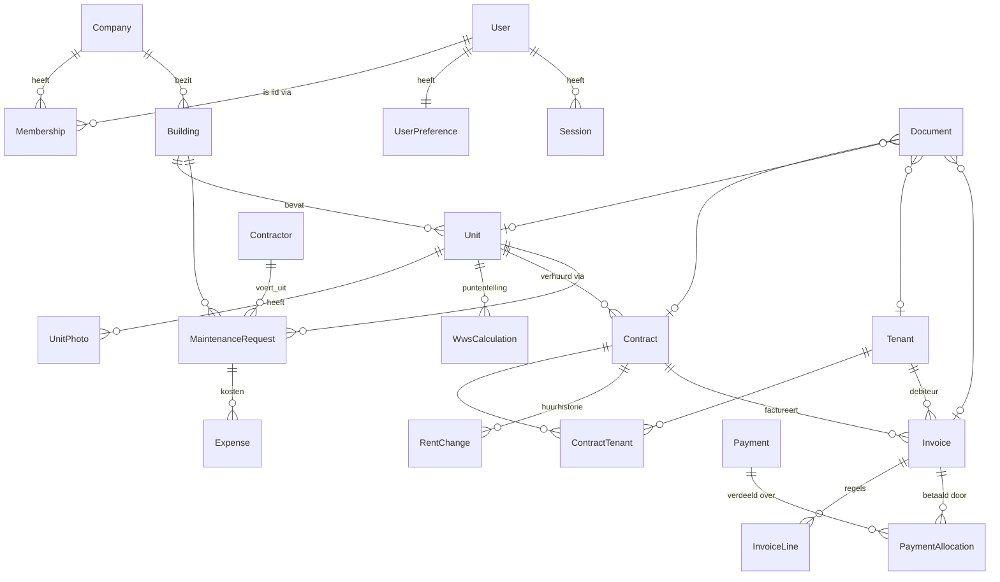

# @puntiq/database

PostgreSQL-schema, migraties en Prisma-client voor BRINLORE PUNTIQ.

## Snel starten

```bash
cp .env.example .env
npm install
npm run db:up            # PostgreSQL 17 in Docker op poort 5433
npm run migrate:deploy   # migraties toepassen
npm run seed             # demodata (login: demo / demo12345)
npm test                 # integratietests op de constraints
```

Schema wijzigen: pas `prisma/schema.prisma` aan en draai `npm run migrate:dev -- --name <omschrijving>`.

## Datamodel



| Domein | Tabellen |
|---|---|
| Toegang | `companies`, `users`, `user_preferences`, `company_memberships`, `company_invitations`, `sessions`, `password_reset_tokens` |
| Vastgoed | `buildings`, `units`, `unit_photos`, `wws_calculations` |
| Verhuur | `tenants`, `contracts`, `contract_tenants`, `rent_changes` |
| Onderhoud | `contractors`, `maintenance_requests` |
| Documenten | `documents` (metadata; bestanden in object storage) |
| Financiën | `invoices`, `invoice_lines`, `payments`, `payment_allocations`, `expenses` |
| Platform | `notifications`, `audit_logs`, `site_settings` |

## Ontwerpkeuzes

- **Multi-tenant.** Elke bedrijfstabel heeft `company_id`; queries filteren daar altijd op, en alle hoofdindexen beginnen ermee. Rollen per bedrijf: `OWNER`, `ADMIN`, `MANAGER`, `VIEWER`. `users.platform_role = ADMIN` is de platformbeheerder.
- **Samengestelde foreign keys** `(company_id, id)` op de kernrelaties (woning→gebouw, contract→woning, contract↔huurder): de database zelf voorkomt dat data van twee bedrijven aan elkaar wordt gekoppeld. Optionele koppelingen (documenten, onderhoud, facturen) gebruiken een gewone FK; daar bewaakt de applicatie de isolatie. Row-Level Security op `company_id` is een logische volgende stap.
- **UUID v7** als primaire sleutel: niet te raden, en tijd-geordend, dus geen index-fragmentatie zoals bij v4. Ze worden door Prisma gegenereerd; bij raw SQL-inserts moet je zelf een id meegeven.
- **Typen.** Geld is `numeric(12,2)`, kalenderdata `date`, tijdstippen `timestamptz(3)`. E-mail en gebruikersnaam zijn `citext` (hoofdletterongevoelig uniek).
- **Verwijderen.** Bedrijf verwijderen ruimt alles op (cascade). Losse verwijderingen die historie zouden breken (woning met contracten, huurder met contract of facturen, gefactureerd contract) worden geblokkeerd. Die beschermende FK's zijn `DEFERRABLE INITIALLY DEFERRED` en worden pas bij `COMMIT` gecontroleerd. Dat is nodig omdat een bedrijfsverwijdering via meerdere cascadepaden tegelijk loopt.
- **WWS-berekeningen** bewaren invoer en uitkomst als JSON plus `rules_version` en `reference_date`, zodat een oude berekening reproduceerbaar blijft als de puntentabel wijzigt. `units.wws_points` / `max_rent` zijn een cache van de laatste berekening.
- **Financiën** volgen een eenvoudige debiteurenadministratie: facturen met regels, betalingen die via `payment_allocations` over facturen worden verdeeld (deelbetalingen en verzamelbetalingen), en kosten aan eigenaarskant in `expenses`. "Achterstallig" is afgeleid (open + vervaldatum verstreken), geen opgeslagen status.

## Constraints buiten Prisma

Prisma kan CHECK-, EXCLUDE- en partiële constraints niet in `schema.prisma` uitdrukken. Ze staan onderaan [de init-migratie](prisma/migrations/20261113113206_init/migration.sql). Prisma laat ze bij volgende migraties ongemoeid (gecontroleerd met `migrate diff`). De belangrijkste:

| Constraint | Bewaakt |
|---|---|
| `contracts_no_overlapping_active` | Geen twee overlappende actieve contracten op één woning (EXCLUDE met `daterange`) |
| `invoices_one_rent_per_period` | Dezelfde huurmaand van een contract wordt nooit twee keer gefactureerd |
| `contract_tenants_one_primary` | Maximaal één hoofdhuurder per contract |
| `invoices_total_consistent`, `invoice_lines_amount_consistent` | Bedragen tellen op |
| `maintenance_requests_has_location` | Onderhoud hoort bij een woning of gebouw |
| `contracts_end_after_start`, `contracts_fixed_term_has_end` | Geldige looptijd |
| diverse `*_format` / `*_range` | KvK (8 cijfers), IBAN, landcode, percentages, termijnen |

Ze worden getest in [tests/constraints.test.ts](tests/constraints.test.ts).
